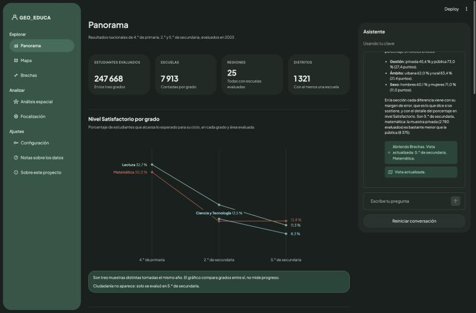
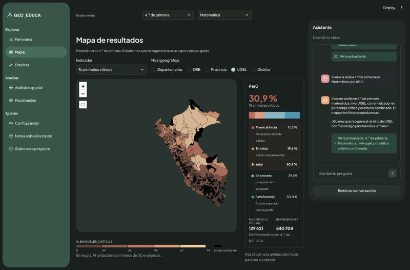
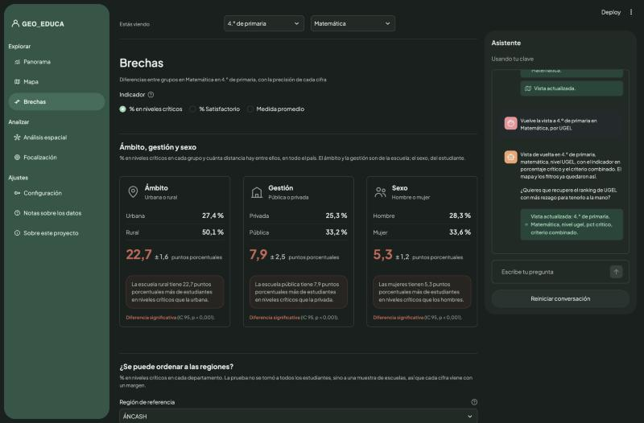
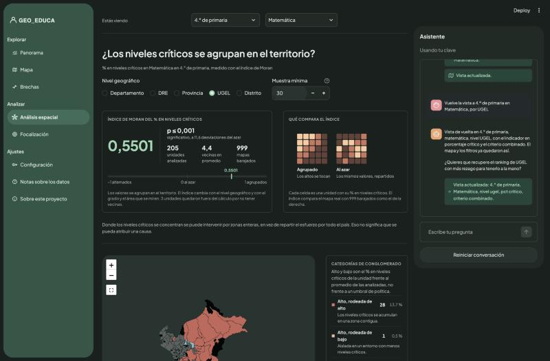
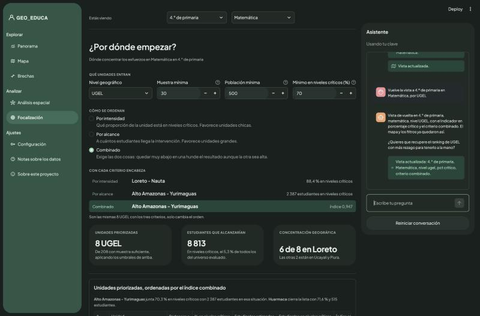

# GEO_EDUCA

Plataforma para explorar los resultados de la **ENLA 2025**, la Evaluación Nacional de
Logros de Aprendizaje que la Oficina de Medición de la Calidad de los Aprendizajes (UMC)
del Ministerio de Educación del Perú aplicó a 248 294 estudiantes de 4.º de primaria y
2.º y 5.º de secundaria. Las bases publicadas traen 247 668 con medida válida, que son
los que analiza esta plataforma.

Los microdatos de la evaluación son públicos, pero llegan en bases con pesos muestrales,
estratos y conglomerados. Para leerlas hace falta saber de muestreo complejo, y eso deja
fuera a mucha gente a la que los resultados le importan: direcciones regionales, UGEL,
docentes, periodistas. Esta plataforma hace ese trabajo una vez y deja las cifras a la
vista, con un asistente al que se le puede preguntar en lenguaje corriente.

Es software libre y los datos son públicos. Cualquiera puede clonarlo, reconstruir el
almacén desde las fuentes originales y comprobar cada número.



## Qué hay dentro

| Sección | Responde |
|---|---|
| Panorama | Cómo le va al país en los tres grados, y qué distancias separan a los grupos |
| Mapa | Dónde se concentran los niveles críticos, por región, DRE, provincia, UGEL o distrito |
| Brechas | Cuánto separa a los grupos, con el margen de error de cada diferencia |
| Análisis espacial | Si el rezago se agrupa en el territorio o se reparte al azar |
| Focalización | Por dónde empezar, con tres criterios que no dan el mismo orden |
| Notas sobre los datos | La fuente, el método de cálculo y los límites de lo que se puede concluir |

### Mapa

Cada unidad geográfica con su porcentaje en niveles críticos. Las unidades con muestra
insuficiente se pintan en negro en lugar de mostrar una cifra que no se sostiene.



### Brechas

Las diferencias entre grupos no se presentan solas: cada una lleva su intervalo de
confianza, calculado con el diseño muestral de la evaluación, y la plataforma dice
cuándo dos cifras no se distinguen entre sí.



### Análisis espacial

El índice de Moran mide si las zonas con más rezago están pegadas unas a otras. En UGEL
de 4.º de primaria en Matemática da 0,5501 con p ≤ 0,001 sobre 999 permutaciones: el
rezago se agrupa, y eso cambia qué tipo de intervención tiene sentido.



### Focalización

Con recursos limitados, por dónde empezar. Tres criterios distintos sobre las mismas
unidades, que a propósito no coinciden: elegir entre ellos es una decisión de política,
no un resultado del dato, y la plataforma no la toma por nadie.



## El asistente

Responde preguntas sobre los datos usando inteligencia artificial, y mueve la vista
según lo que se le pida: cambia el grado, el área, el nivel geográfico o la sección que
estás viendo.

La regla que lo gobierna es que **toda cifra que da sale de una consulta hecha en el
momento**, nunca de la memoria del modelo. Tiene diez herramientas que consultan el
almacén; cuando escribe SQL, la consulta pasa por un validador que rechaza las
agregaciones sobre microdatos que olvidan el peso muestral, que es el error que no se
nota porque no da ningún mensaje. Si una respuesta trae cifras que ninguna herramienta
devolvió, la propia respuesta lo advierte.

Aun así, la inteligencia artificial se equivoca. Conviene comprobar lo que vaya a usarse
para algo.

### Probarlo con tu propia clave

El asistente necesita una clave de API. En **Configuración** se puede poner la tuya, de
cualquiera de estos cuatro proveedores:

| Proveedor | Dónde conseguir la clave |
|---|---|
| DeepSeek | https://platform.deepseek.com |
| OpenAI | https://platform.openai.com/api-keys |
| Anthropic | https://platform.claude.com/settings/keys |
| Google | https://aistudio.google.com/apikey |

La clave vive solo en la memoria de esa sesión: no se escribe en disco, ni en el
navegador, ni en ningún registro, y no se muestra de vuelta. Al cerrar la pestaña
desaparece. El consumo corre por cuenta de quien la pone, así que conviene ponerle un
límite de gasto en el panel del proveedor antes de usarla.

Quien publique la aplicación puede además dejar una clave compartida del proyecto, en
los secretos de Streamlit o en una variable de entorno llamada `DEEPSEEK_API_KEY`, para
que cualquiera pueda probarla sin registrarse. En ese caso aplica un tope de quince
consultas por sesión, aunque la protección de verdad es el límite de gasto que se le
ponga a la clave en el panel del proveedor.

### Preguntas de ejemplo

```
¿Dónde está peor matemática en primaria?
Compara Lima con Loreto
¿Los niveles críticos se agrupan en el territorio?
¿Por dónde habría que empezar?
Muéstrame el mapa de Loreto por distrito
¿Hay brechas por gestión en secundaria?
Ordena la focalización por alcance
```

Cuando la respuesta se puede ver en la pantalla y los filtros no la están mostrando, el
asistente se ofrece a moverlos. Nunca lo hace sin que se lo acepten.

## Cómo está hecho

Todas las cifras se calculan con los pesos del diseño muestral. Las que la UMC publica
se usan como control: el almacén trae 35 comprobaciones contra las cifras oficiales y
de coherencia interna, y el mayor desvío es de 0,05 puntos porcentuales, que es
redondeo.

| | |
|---|---|
| Almacén | DuckDB, reconstruible desde los microdatos originales |
| Estimación | Pesos, estratos y conglomerados del diseño de la ENLA |
| Intervalos | Logit para proporciones, Wald para diferencias |
| Análisis espacial | Índice de Moran y conglomerados locales, contigüidad Queen |
| Geometrías | Fronteras administrativas del Perú publicadas por OCHA |
| Interfaz | Streamlit, Plotly y Folium |
| Pruebas | 198, contra el paquete `survey` de R en lo que toca al muestreo |

## Ponerlo a andar

```bash
git clone https://github.com/wiricardo/geo-educa.git
cd geo-educa
python3 -m venv .venv
.venv/bin/pip install -r requirements.txt
.venv/bin/streamlit run app/app.py
```

El repositorio trae el almacén ya construido, así que eso es todo lo que hace falta para
verlo andar.

Los microdatos de origen no se versionan, porque son públicos y pesan. Para reconstruir
el almacén desde cero y comprobar cada cifra hay que descargarlos de las fuentes que
documenta [FUENTES.md](FUENTES.md) y correr la ingesta:

```bash
.venv/bin/python ingest/build_geo.py
.venv/bin/python ingest/build_warehouse.py
```

Las pruebas:

```bash
.venv/bin/python -m pytest -q
```

Hace falta Python 3.13.

## Fuentes y licencias

Los microdatos de la ENLA 2025 son públicos y los distribuye la UMC en
http://umc.minedu.gob.pe/enla2025. Las fronteras administrativas vienen de OCHA, con
licencia CC BY-IGO. El detalle de cada archivo, su origen y qué se hace con él está en
[FUENTES.md](FUENTES.md).

Este proyecto no está afiliado al Ministerio de Educación del Perú ni a la UMC.

## Autoría

Hecho por **Ricardo Pacheco**. https://github.com/wiricardo
